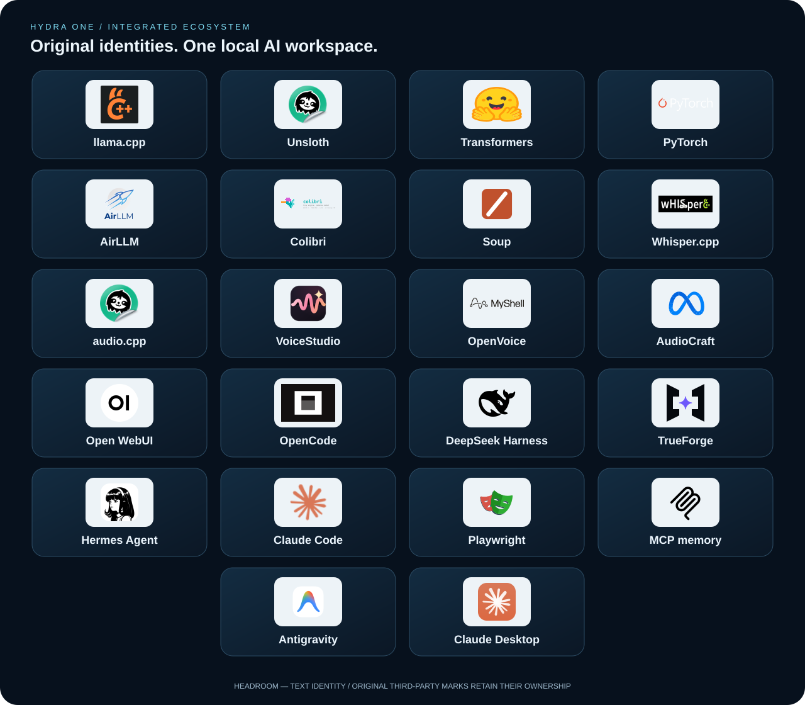
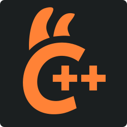
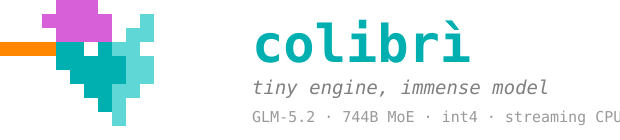
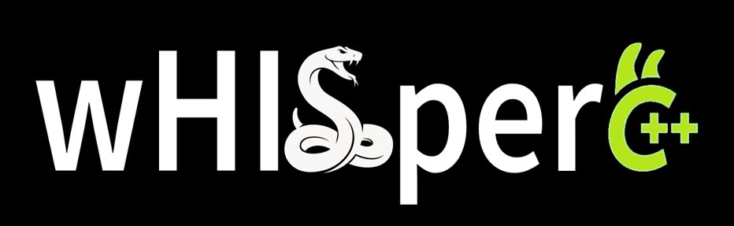
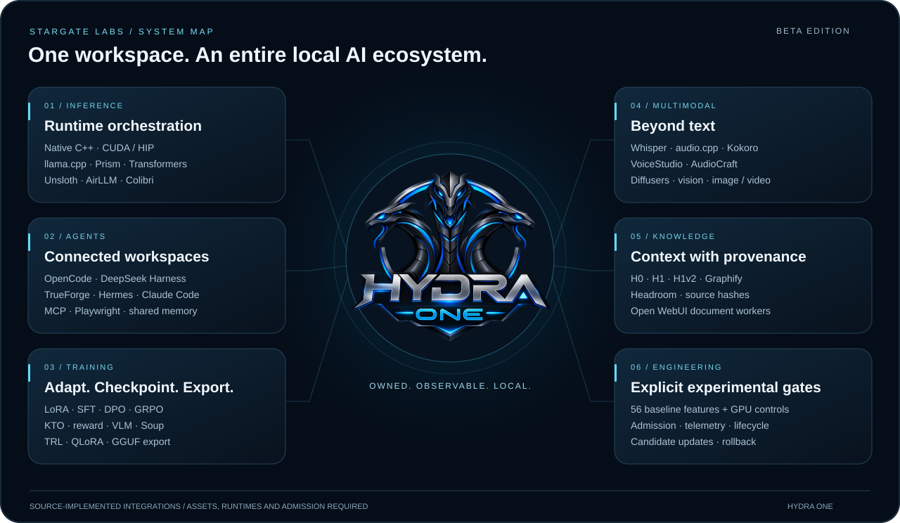

# Hydra One

**Hybrid inference. Local models. A controlled laboratory.**

[Italiano](README.md) · [English](README.en.md) · [Installation](docs/INSTALL.en.md) · [Features](docs/FEATURES.md) · [Credits](docs/CREDITS.en.md)

  

<!-- logo-directory:start -->

## The applications and tools in our workspace

<!-- logo-directory:end -->

Hydra One is the **Stargate Labs beta**, based on Strata. It brings together our HYDRA One integration, a local-model web workspace and tools to observe, measure and control execution. This publication comes from **our modified local sources**, with native base version 0.1.38, rather than today's upstream main branch.

<strong>Integrated applications: logos, functions and authors</strong> — expand details

Integration roles are documented here on the main page. Each retains its own runtime requirements, license and capabilities; an adapter does not imply parity with every feature of the original application.

| Logo | App / Source | Its role in our mod | Authors and acknowledgements |
|---|---|---|---|
|  | **[llama.cpp](https://github.com/ggml-org/llama.cpp)** | GGUF engine, native libraries, format tooling and optional server transport. | ggml authors and contributors |
|  | **[Unsloth](https://github.com/unslothai/unsloth)** | Selected Python environment, inference/QLoRA integration and owned Studio service. | Unsloth team and contributors |
|  | **[Transformers](https://github.com/huggingface/transformers)** | Local Safetensors text/vision runtime and model metadata integration. | Hugging Face and contributors |
|  | **[PyTorch](https://github.com/pytorch/pytorch)** | Tensor execution, device/runtime integration and training dependencies. | PyTorch contributors |
|  | **[AirLLM](https://github.com/lyogavin/airllm)** | Optional local layer-streaming backend and isolated runtime selection. | lyogavin and AirLLM contributors |
|  | **[Colibri](https://github.com/JustVugg/colibri)** | Isolated engine launcher, controls, model routing and System One integration. | JustVugg and Colibri contributors |
|  | **[Soup](https://github.com/MakazhanAlpamys/Soup)** | Bundled planning modules and managed training integration; original Apache notices retained. | Makazhan Alpamys / Soup Team |
|  | **[Whisper.cpp](https://github.com/ggml-org/whisper.cpp)** | Local ASR and translation. Selected distributions also use the credited Unsloth fork. | ggml authors and Whisper.cpp contributors |
|  | **[audio.cpp](https://github.com/unslothai/audio.cpp)** | Selected local speech runtime. Displayed mark identifies Unsloth, not a separate audio.cpp logo. | Unsloth distribution and upstream contributors |
|  | **[VoiceStudio](https://github.com/debpalash/VoiceStudio)** | Local API/MCP integration, jobs, profiles and rendering workflows. | debpalash and VoiceStudio contributors |
|  | **[OpenVoice](https://github.com/myshell-ai/OpenVoice)** | Optional voice-conversion model/runtime path; task-specific asset checks. | MyShell and OpenVoice contributors |
|  | **[AudioCraft](https://github.com/facebookresearch/audiocraft)** | Music and audio generation, conditioning and training adapters. | Meta / AudioCraft contributors |
|  | **[Open WebUI](https://github.com/open-webui/open-webui)** | Original document/OCR/retrieval workers reused by our local adapter; no second dashboard claimed. | Open WebUI contributors |
|  | **[OpenCode](https://github.com/anomalyco/opencode)** | Original harness transport, workspace/session integration and candidate updates. | Anomaly and OpenCode contributors |
|  | **[DeepSeek Harness](https://github.com/deepseek-ai/deepseek-harness)** | Original harness integration and official package/version mapping. | DeepSeek and harness contributors |
|  | **[TrueForge](https://github.com/truefoundry/trueforge)** | Harness integration with shared browser/memory services and candidate management. | TrueFoundry and contributors |
|  | **[Hermes Agent](https://github.com/NousResearch/hermes-agent)** | Original agent integration, project services and isolated source candidate workflow. | Nous Research and contributors |
|  | **[Claude Code](https://github.com/anthropics/claude-code)** | Native CLI/harness integration and signed official candidate checks; no claim to redistribute its implementation. | Anthropic |
|  | **[Playwright](https://github.com/microsoft/playwright-mcp)** | Shared MCP browser service and verified candidate activation. | Microsoft and Playwright contributors |
|  | **[MCP memory](https://github.com/modelcontextprotocol/servers)** | Shared memory-server contract and project-scoped MCP configuration. | Model Context Protocol contributors |
| Headroom | **[Headroom](https://github.com/headroomlabs-ai/headroom)** | Project-scoped routing metadata, runtime contract and MCP integration. | Headroom Labs and contributors |

<!-- user-capabilities:start -->

## A personal project, shared openly

Hydra One grew out of my own needs and the way I work with local AI. Its design choices, integrations and features reflect my priorities: they may resonate with other users, or serve needs different from theirs. I chose to share the project to make that work available, invite constructive discussion and offer a useful starting point for anyone who wants to explore it or adapt it to their own needs.

<strong>What you can do with Hydra One</strong> — expand details

The mod brings these workflows into one workspace. Operations require the indicated models, runtimes and capabilities; the beta does not claim they are all installed or universally qualified.

### Modelli e chat

**Load a local model** — Select GGUF or a Safetensors checkpoint, check the required engine and start its compatible path. Native packs and Prism formats retain their own adapters. [Implementazione / Source](serve/optional_backends.py)

**Open the dashboard before loading weights** — Lazy startup makes the interface available before model loading; inspect the workspace and choose when to start inference. [Implementazione / Source](serve/server.py)

**Use different engines in one workspace** — Choose HYDRA adapters, the native engine, llama.cpp, Transformers/PEFT, Unsloth, AirLLM, Colibri or a compatible local API according to available dependencies. [Implementazione / Source](serve/optional_backends.py)

**Chat and organize work** — Use chat, history and the conversation archive, retaining organization metadata in the existing interface rather than another parallel chat. [Implementazione / Source](serve/web/app.js)

**Connect applications to your local API** — The server exposes OpenAI- and Anthropic-compatible routes for external clients, with explicit validation of structured output. [Implementazione / Source](serve/structured.py)

### Cataloghi LLM

**Discover models and compare publications** — Browse categories, authors, versions, variants and files. Inspect model cards, base models and licenses before choosing an installation. [Implementazione / Source](serve/optional_catalogue.py)

**Discover models already on disk** — Local inventory scans configured roots and known caches, distinguishes file roles and recognizes split model files. [Implementazione / Source](serve/local_model_discovery.py)

**Download and import selected assets** — Use byte-level download progress, split-file handling and local imports. Availability, disk space and access terms still apply. [Implementazione / Source](serve/studio_model_download.py)

### Agenti e strumenti

**Use integrated agents and coding tools** — The workspace connects OpenCode, DeepSeek Harness, TrueForge, Hermes and Claude Code through their original paths, with session and candidate management. [Implementazione / Source](serve/original_harness_routes.py)

**Provide MCP tools to chat** — Connect configured MCP services and shared browser/memory tools. Tool calling remains dependent on the selected model. [Implementazione / Source](serve/mcp.py)

**Browse prompts and skills** — The interface library exposes prompts and skills in the workspace. Imported library content is not automatically a new native Hydra component. [Implementazione / Source](serve/web/index.html)

### Documenti e memoria

**Bring documents into chat** — Import PDFs, DOCX and text through document workflows; use extraction and OCR when the required local runtime and weights are available. [Implementazione / Source](serve/open_webui_runtime.py)

**Find passages and inspect sources** — Organize collections, search the library and retain document name, page and position. BM25, semantic and hybrid retrieval have distinct requirements. [Implementazione / Source](serve/open_webui_runtime.py)

**Manage context through HYDRA** — Use H0/H1/H1v2 paths, local graph, source hashes and context budgets, with admission checks for changed or out-of-scope sources. [Implementazione / Source](serve/hydra_graph_memory.py)

### Training e modelli

**Train LoRA adapters** — Prepare datasets and explicit local training settings; validate runner, device, checkpoints and export destinations. [Implementazione / Source](serve/local_training.py)

**Experiment with fine-tuning methods** — Source exposes SFT, DPO, GRPO, KTO, reward and VLM options, with runner/device restrictions rather than interchangeable GPU paths. [Implementazione / Source](serve/training_options.py)

**Convert and export models** — GGUF conversion is an owned, cancellable job with persisted outcomes and checked destinations. [Implementazione / Source](serve/local_export.py)

### Voce e audio

**Transcribe and translate audio** — Local Whisper provides language/decoding controls, segments and subtitles using installed model assets and runtime. [Implementazione / Source](serve/local_audio.py)

**Generate speech from text** — Use the selected audio.cpp runtime and supported TTS paths; the lab has a Kokoro adapter separate from chat-model loading. [Implementazione / Source](serve/local_speech.py)

**Manage voice-production workflows** — VoiceStudio connects API/MCP, profiles, jobs and rendering, alongside dedicated audio library/editing modules. [Implementazione / Source](serve/voicestudio.py)

**Work on music and separation** — AudioCraft and generative workers handle registered tasks with compatible models and conditioning, alongside a dedicated audio-separation path. [Implementazione / Source](serve/local_generative_audio.py)

### Immagini e video

**Use vision models in chat** — Pair a valid GGUF projector or the appropriate Transformers vision path. Backend capabilities determine accepted inputs. [Implementazione / Source](serve/local_vision.py)

**Generate images and video locally** — Diffusers workers cover explicit Stable Diffusion, SDXL, inpainting and video families, requiring compatible pipelines, weights and resources. [Implementazione / Source](serve/local_visual_generation.py)

### Prestazioni e Benchmark

**Measure models through a protocol** — Configure repetitions, warmup, prompt and token budget. Record actual samples, cancel jobs and retain outcomes in the workbench. [Implementazione / Source](serve/optional_benchmark.py)

**Compare configurations without mixing metric scopes** — Compare consistent reports and model identities; separate HTTP, TTFT, decode and prefill. Inspect archives, filters, charts and CSV exports. [Implementazione / Source](serve/benchmark_comparison.py)

**Evaluate alternatives with System One** — Colibri workspace and HYDRA contracts distinguish choice, yes/no, score and prefix-scoring paths; equivalence requires dedicated verification. [Implementazione / Source](serve/colibri_controls.py)

**Control experimental features** — Inspect all 59 controls, dependencies and parameters, prepare versioned changes and retain missing-hardware/runtime gates. [Implementazione / Source](serve/hydra_feature_control.py)

### Gestione del sistema

**Observe resources and lifecycle** — Monitor and records distinguish backend work, host telemetry and historical evidence. Leases, cancellation, shutdown and idle unload manage owned processes. [Implementazione / Source](serve/process_lifecycle.py)

**Update while preserving the mod** — Check sources/versions, stage isolated candidates, validate dependencies and select or restore supported paths without confusing downloads with activation. [Implementazione / Source](serve/update_center.py)

**Preserve and recover work** — Backups verify editable-source hashes. HYDRA recovery restores missing files while retaining modified existing files. [Implementazione / Source](serve/customization_backup.py)

<!-- user-capabilities:end -->

## Inside Hydra One

| Area | Included implementation | Source |
|---|---|---|
| HYDRA One | Hybrid controller, memory budgets, planning, sidecar and monitoring | [Python engine](hydra-engine/python/) · [integration](serve/hydra_one.py) |
| Native runtime | Owned process lifecycle, admission checks, generation and CPU scoring | [Adapter](serve/hydra_native.py) · [loader](serve/hydra_native_text_server.py) |
| Laboratory | 56 inventoried features, versioned controls, explicit dependencies and gates | [Full register](docs/FEATURES.md) |
| Memory and retrieval | Local graph, H0/H1/H1v2, source provenance and context budgets | [Graph memory](serve/hydra_graph_memory.py) |
| Models and backends | Hugging Face catalogue, GGUF/Safetensors and optional integrations | [Catalogue](serve/catalogue.py) · [backends](serve/optional_backends.py) |
| Workspace | Chat, MCP, monitor, benchmarks and component management | [Interface](serve/web/index.html) · [server](serve/server.py) |

## Our all-in-one integration

The project brings together inference, chat, agents, MCP, training and multimodal production. The platform guide distinguishes each integration type and links its implementation.

| Area | Components and included work |
|---|---|
| **Inference** | HYDRA One · native C++/CUDA/HIP · llama.cpp · Prism · Transformers/PEFT · Unsloth · AirLLM · Colibri · local APIs |
| **Agents / apps** | OpenCode · DeepSeek Harness · TrueForge · Hermes · Claude Code · native Claude/Antigravity workspace |
| **Tools / memory** | MCP · Playwright browser · shared memory · Headroom · local graph · H0/H1/H1v2 · source provenance |
| **Training** | LoRA · SFT · DPO · GRPO · KTO · reward · VLM · TRL CPU · Soup · Unsloth QLoRA · checkpoints · GGUF export |
| **Multimodal** | Whisper ASR · audio.cpp / Kokoro TTS · VoiceStudio · AudioCraft · source separation · Diffusers image/video · vision projectors |
| **Workspace services** | Open WebUI document/OCR/semantic/reranker workers · model catalogue · downloads/imports · component staging/rollback · telemetry |
| **Research / beta** | 56 baseline experimental features + 3 GPU controls · admission · CPU scheduling · IOCP · scoring · tiering contracts · benchmark history |

**[Platform guide / Guida completa](docs/PLATFORM.en.md)** · [Every source module / Tutti i moduli](docs/MODULES.md) · [Experimental register / Registro sperimentale](docs/FEATURES.md)

These integrations and paths are present in source. See the guide for each component’s prerequisites and gates. Model support depends on architecture, format, runtime and resources; unverified universal compatibility is not claimed.

## The engineering workbench and platform services

### [Performance and Benchmark](docs/WORKBENCH.en.md)

Performance and Benchmark are the workbench for observing models and evaluating the mod’s enhancements. Performance organizes measurements; Benchmark configures and executes tests against the selected backend. Their purpose is to bind a result to its model, runtime, protocol and configuration, rather than publish an unqualified leaderboard. Cache, context, thread and backend changes must be compared through consistent experiments.

### [LLM catalogues and compatibility](docs/CATALOGUES.en.md)

Search results are not automatically executable models. The catalogues connect Hugging Face discovery, publication metadata, variants, files, local inventory and runtime compatibility. Native and optional paths have distinct requirements: an expert pack must not be launched as generic GGUF, and Prism-specific formats must not silently fall back to incompatible runtimes.

### [Updates, backup and recovery](docs/UPDATES.en.md)

The Update Center connects environment inventory, official sources, verified downloads, isolated candidates, validation and component selection. Our adapter is designed to preserve settings, modified sources and data while engines and integrated applications evolve. Available release, downloaded package, validated candidate and active runtime are separate states.

<!-- integrated-platform:start -->

<strong>All inference and generation paths</strong> — expand details

| Engine | Role and implementation | Requirements and boundaries |
|---|---|---|
| 
 <b>HYDRA One</b>
 | Controller ibrido / Hybrid controller. Planning, budgets, sidecar, storage identity, lifecycle and graph integration. [Source](serve/hydra_one.py) | Backend-owned model residency; not a replacement tensor executor. |
| 
 <b>Native engine</b>
 | C++ / CUDA / HIP. Native model packs, expert execution, cache, speculative paths and CPU/GPU work sharing. [Source](CMakeLists.txt) | Model-pack and toolchain specific; upstream measurements remain attributed. |
| 
 <b>llama.cpp</b>
 | GGUF + local API. Owned server process, split GGUF handling, configuration, model discovery and request transport. [Source](serve/optional_backends.py) | Architecture, quantization and installed runtime must match. |
| **Prism llama.cpp** Specialized runtime; no separate verified logo | Specialized GGUF. Pinned Prism loader source, model-family checks and isolated native candidate. [Source](serve/gguf_runtime_compatibility.py) | Distinct runtime for compatible Prism formats; no silent generic fallback. |
| 
 <b>Transformers / PEFT</b>
 | Safetensors + LoRA. Owned Python text inference, CPU FP32, device-specific GPU paths, local adapters and thread controls. [Source](serve/safetensors_runtime.py) | Dependencies and model class required; GPU admission is gated separately. |
| 
 <b>Unsloth</b>
 | Inference / QLoRA / Studio. Python backend integration, native Studio service ownership and candidate update handling. [Source](serve/unsloth_workspace.py) | Installed Unsloth environment required; upstream authentication and frame policy preserved. |
| 
 <b>AirLLM</b>
 | Layer streaming. Project runtime selection and CPU disk-backed layer-streaming integration. [Source](serve/airllm_runtime.py) | Compatible model and runtime needed; disk streaming is not a guaranteed speedup. |
| 
 <b>Colibri</b>
 | Isolated optional engine. Official isolated launcher, controls, local endpoint validation and component updates. [Source](serve/colibri_workspace.py) | Full model assets and matching runtime required; catalogue listing is not successful inference. |
| 
 <b>Soup</b>
 | Training integration. Bundled upstream planning modules, isolated package selection and training runners. [Source](serve/soup_runtime.py) | CPU/native/GPU runner restrictions are enforced by training options. |
| **Local API** API transport | OpenAI-compatible transport. Attach compatible local model APIs, normalize messages, tools and response handling. [Source](serve/optional_inference.py) | Capabilities are reported by the selected model/API; tools and vision are not assumed. |
| 
 <b>Whisper.cpp</b>
 | ASR / translation. Owned local transcription, language controls, decoding parameters, segments and subtitles. [Source](serve/local_audio.py) | Whisper model and selected binary required. |
| 
 <b>audio.cpp / Kokoro</b>
 | Text-to-speech. Local CPU speech and an explicit Kokoro laboratory adapter. [Source](serve/local_speech.py) | Registered speech model/runtime required; separate from a chat-model loader. |
| 
 <b>Diffusers</b>
 | Images / video. Explicit Stable Diffusion, SDXL, inpainting, Stable Video Diffusion and TextToVideoSD worker families. [Source](serve/local_visual_generation.py) | Only implemented pipeline families and installed models; no universal media support. |
| 
 <b>AudioCraft / audio workers</b>
 | Music / effects / voice. Conditioning, native integration, local generation and managed audio workflows. [Source](serve/local_generative_audio.py) | Task-specific assets, conditioning and runtime required. |

<strong>Workspace functions, area by area</strong> — expand details

### Agents and coding

OpenCode, DeepSeek Harness, TrueForge, Hermes Agent and Claude Code component maps; original transport, sessions and update candidates.

[harness_updates](serve/harness_updates.py) · [original_harness_transport](serve/original_harness_transport.py) · [original_harness_routes](serve/original_harness_routes.py) · [hermes_integration](serve/hermes_integration.py)

### Native workspace

Dashboard, Claude and Antigravity workspace kinds; owned native host and local URL validation.

[native_workspace](serve/native_workspace.py) · [native_window_host](serve/native_window_host.py) · [native_workspace_routes](serve/native_workspace_routes.py)

### MCP and tools

Project MCP configuration, chat tool bridge, shared browser/memory services and controlled candidate activation.

[mcp](serve/mcp.py) · [project_mcp](serve/project_mcp.py) · [shared_agent_services](serve/shared_agent_services.py) · [optional_tools](serve/optional_tools.py)

### Browser and memory services

Playwright MCP and MCP memory server integrated through the shared service configuration.

[trueforge_setup](serve/trueforge_setup.py) · [shared_agent_services](serve/shared_agent_services.py)

### Headroom

Project-scoped runtime metadata, routing enablement and MCP launch contract.

[headroom_integration](serve/headroom_integration.py)

### Open WebUI functions

Document import, local workers for OCR, semantic processing and reranking. Existing module states no separate Open WebUI HTTP server/UI.

[open_webui_runtime](serve/open_webui_runtime.py) · [open_webui_ocr_worker](serve/open_webui_ocr_worker.py) · [open_webui_semantic_worker](serve/open_webui_semantic_worker.py) · [open_webui_reranker_worker](serve/open_webui_reranker_worker.py)

### Model library

HF search, author/model-card metadata, categories, local discovery, split-file identity, imports and byte-level download progress.

[optional_catalogue](serve/optional_catalogue.py) · [local_model_discovery](serve/local_model_discovery.py) · [studio_model_download](serve/studio_model_download.py) · [studio_model_import](serve/studio_model_import.py) · [gguf_parts](serve/gguf_parts.py)

### Fine-tuning

LoRA, explicit SFT/DPO/GRPO/KTO/reward/VLM options; CPU TRL, Soup and Unsloth QLoRA runner policies; checkpoint validation.

[local_training](serve/local_training.py) · [training_options](serve/training_options.py) · [advanced_training_runtime](serve/advanced_training_runtime.py) · [vlm_training_runtime](serve/vlm_training_runtime.py)

### Export and datasets

Owned cancellable GGUF conversion, dataset upload, output validation and checkpoint/resume handling.

[local_export](serve/local_export.py) · [vision_dataset_upload](serve/vision_dataset_upload.py) · [train_local_lora](tools/train_local_lora.py)

### Vision

GGUF projector pairing, CPU default and capability-checked GPU offload; Transformers vision paths and multimodal capability reporting.

[local_vision](serve/local_vision.py) · [transformers_vision](serve/transformers_vision.py) · [multimedia_capabilities](serve/multimedia_capabilities.py)

### Voice production

VoiceStudio jobs/profiles/rendering, local speech, audio library/editing and audiobook planning tests.

[voicestudio](serve/voicestudio.py) · [voicestudio_jobs](serve/voicestudio_jobs.py) · [voicestudio_profiles](serve/voicestudio_profiles.py) · [voicestudio_render](serve/voicestudio_render.py) · [audio_library](serve/audio_library.py) · [audio_edit](serve/audio_edit.py)

### Music and audio

AudioCraft conditioning and training, local generative audio, source separation and task-specific capability checks.

[audiocraft_native](serve/audiocraft_native.py) · [audiocraft_conditioning](serve/audiocraft_conditioning.py) · [audiocraft_training](serve/audiocraft_training.py) · [local_generative_audio](serve/local_generative_audio.py) · [local_separation](serve/local_separation.py)

### Graph and retrieval

Explicit local corpus; SQLite memory, H0/H1/H1v2 graph paths, exact frontend/template reuse, source hashes, freshness and context guards.

[hydra_graph_memory](serve/hydra_graph_memory.py) · [hydra_graph_optional](serve/hydra_graph_optional.py) · [hydra_graphify_runtime](serve/hydra_graphify_runtime.py) · [hydra_graph](serve/hydra_graph.py)

### Laboratory and experiments

56 baseline features plus separate GPU controls; dependency resolution, preview/apply/rollback, execution admission and historical evidence.

[hydra_feature_control](serve/hydra_feature_control.py) · [hydra_lab_app](serve/hydra_lab_app.py) · [hydra_lab_benchmarks](serve/hydra_lab_benchmarks.py) · [hydra_capability_contracts](serve/hydra_capability_contracts.py)

### Native performance research

IOCP source consumer, CPU scheduling, bounded request-local checkpoints, raw scoring, System One bridge contracts and blocked hardware-dependent paths.

[direct_file](src/platform/direct_file.cpp) · [hydra_cpu_scheduling](serve/hydra_cpu_scheduling.py) · [hydra_scoring_runtime](serve/hydra_scoring_runtime.py) · [hydra_system_one_bridge](serve/hydra_system_one_bridge.py)

### Metrics and verification

Run history, timing, model/runtime identity, live monitoring, source provenance and explicit task-completion contracts.

[instrumentation](serve/instrumentation.py) · [verification_history](serve/verification_history.py) · [hydra_task_completion](serve/hydra_task_completion.py) · [hydra_lab_live](serve/hydra_lab_live.py)

### Process and resource control

Owned children, exclusive GPU leases, cancellation, graceful shutdown, idle unloading and Windows Job limits.

[process_lifecycle](serve/process_lifecycle.py) · [gpu_lease](serve/gpu_lease.py) · [native_graceful_shutdown](serve/native_graceful_shutdown.py) · [winjob](serve/winjob.py)

### Updates and recovery

Official source checks, candidate staging, source fingerprints, explicit activation/rollback, dependency supervision and source-only recovery capsule.

[update_center](serve/update_center.py) · [safe_update](serve/safe_update.py) · [dependency_supervisor](serve/dependency_supervisor.py) · [hydra_recovery](serve/hydra_recovery.py)

### APIs and output

OpenAI/Anthropic-compatible server routes, structured response validation, request monitoring and model lifecycle routes.

[server](serve/server.py) · [structured](serve/structured.py) · [model_engine_routes](serve/model_engine_routes.py)

<strong>Complete experimental control register</strong> — expand details

56 baseline features plus 3 separate GPU controls. Control type and current gates are shown; these are not hardware qualification or a promise to support every model.

| ID | Feature and implementation | Control / current gate |
|---|---|---|
| `V7-A-001` | **Backend CPU** Historical CPU/Vulkan group reconciled: this control gates CPU; GPU backends have separate quarantined controls. | switch Admission and runtime prerequisites apply |
| `V7-A-002` | **Offload parziale/completo e device** native runtime logs and buffer allocations; CPU and Vulkan paths | switch QUARANTINED / Partial/full GPU offload and device selection require the separate GPU recovery gate. |
| `V7-A-003` | **Riuso runtime nel benchmark CPU** Qwen CPU normal runner:ON keeps one owned runtime across warmup/samples;OFF closes it after each request and reloads serially. Lock remains held through final cleanup. No resident model across independent admissions. | switch Admission and runtime prerequisites apply |
| `V7-A-004` | **Capability detection e admission** test_hydra_start_admission; test_hydra_benchmark_v4; blocked catalog remains separate | mandatory Admission and runtime prerequisites apply |
| `V7-A-005` | **Circuit breaker e fallback** test_hydra_guard_failures; test_hydra_graph_optional; provider-off real 503 | mandatory Admission and runtime prerequisites apply |
| `V7-B-006` | **Prompt cache nativa** 7 cache-enabled native samples; specialized repeated exact prefix; promotion bracket checked | switch Admission and runtime prerequisites apply |
| `V7-B-007` | **Flash Attention Vulkan off/on/auto (campagna finita)** single-variable seven-sample comparison | switch QUARANTINED / Flash Attention requires an explicit finite v18/v19 campaign and its specific ON control; historical GPU profiles remain quarantined. |
| `V7-B-008` | **Batch e ubatch Bonsai** v6 baseline drift guard; no new Bonsai tuning promoted | request_only QUARANTINED / Prism batch/ubatch experiments require quarantined Vulkan path; historical NO_GO retained. |
| `V7-B-009` | **Thread CPU e affinità** 2 threads and owned process affinity verified; thread sweep not performed | switch Admission and runtime prerequisites apply |
| `V7-B-010` | **Timing nativi e metriche stadio** native prompt/decode counters; TTFT and pure prefill compute NOT_AVAILABLE | mandatory Admission and runtime prerequisites apply |
| `V7-B-011` | **Contesto, sampler e seed** 512 context; raw prompt; greedy seed42 max16 frozen across profiles | switch Admission and runtime prerequisites apply |
| `V7-C-012` | **RAM/VRAM admission e RSS** 12GiB RAM admission; 4GiB VRAM reserve; periodic RSS is not hard cap | mandatory Admission and runtime prerequisites apply |
| `V7-C-013` | **Checkpoint prefisso scorer CPU** Request-local native CPU prefix state:checkpoint_tier0=RAM,1=temporary disk file. Disk mode releases retained allocation and restores exact bytes before llama_state_set_data. Exclusive file, checksum, budget and deletion on child exit; no fallback. Not model-weight tiering or cross-request cache. | switch Admission and runtime prerequisites apply |
| `V7-C-014` | **Budget checkpoint scorer CPU** Owns a bounded request-local native CPU full-state checkpoint for exact prefix reuse across alternatives. Cache OFF re-evaluates prefixes. Not GPU KV, cross-request conversation storage or Colibri state. | switch Admission and runtime prerequisites apply |
| `V7-C-015` | **Expert cache slot storage** partial metadata/residency implementation; cache-hit grouped execution not wired; native model pack excluded | request_only BLOCKED / COMPATIBLE_COMPLETE_MOE_TARGET_REQUIRED |
| `V7-C-016` | **Stato nativo Bonsai** Prism v21 session-local native slot save/erase/restore with model/runtime/session identity, SHA256, disk budget, cancellation and cleanup. CPU continuation restored158337104 bytes and reused22 tokens. GPU also requires a finite grant: native state transfer succeeded but repeated-prefix reuse was0; that mode is refused. Not weight tiering. | switch Admission and runtime prerequisites apply |
| `V7-C-017` | **Tiering indice Graphify** Owns repository index data only:0 cold/source disk,1 warm/compressed RAM,2 hot/parsed RAM. Source archive re-read and hashed every request. Not model-weight tiering. | switch Admission and runtime prerequisites apply |
| `V7-C-018` | **Limite commit Windows obbligatorio** Windows process and aggregate Job commit limits:8 GiB for small-model/functional paths,24 GiB for native families. Flags and limits read back before suspended child assignment/resume. Not an RSS or physical-RAM cap; historical peak-accounting discrepancy retained. | mandatory Admission and runtime prerequisites apply |
| `V7-C-019` | **OOM e recupero controllato** budget/cancellation/error tests with fixtures; no deliberate system OOM | mandatory Admission and runtime prerequisites apply |
| `V7-D-020` | **H0 lexical SQLite retrieval** temporary synthetic authorized corpus, hash/scope; real SQLite reads | switch Admission and runtime prerequisites apply |
| `V7-D-021` | **H1 embeddings locali** local CPU encoder and temporary index; provider stopped; historical quality HOLD unchanged | switch Admission and runtime prerequisites apply |
| `V7-D-022` | **H1 v2 coverage/ranking** real CPU retrieval; coverage contracts tested; historical quality HOLD unchanged | switch Admission and runtime prerequisites apply |
| `V7-D-023` | **Context Compiler e RequestGuard** real graph context fed to Qwen; native tokenizer, one selected node; guards remaining zero | switch Admission and runtime prerequisites apply |
| `V7-D-024` | **Bypass query breve** Ciao uses standard path retrieval_cost_not_justified | switch Admission and runtime prerequisites apply |
| `V7-D-025` | **Provenienza hash scope freshness** test_hydra_graph_memory and optional; tamper/expiry/authorization fixtures | mandatory Admission and runtime prerequisites apply |
| `V7-D-026` | **Graphify — contesto dal repository** Selects current local repository sources for Graph retrieval and Context Compiler; validates source identity and freshness. No GPU/weight acceleration. | switch BLOCKED / Missing local repository graph: C:\Users\Stargate\Desktop\BattleTron-LSC-smartConnect\.diagnostics\publish\hydra-one\graphify-out\graph.json |
| `V7-D-027` | **Snapshot e invalidazione indici** HYDRA graph_hybrid and v2 tests; native CPU integration on new corpus | mandatory Admission and runtime prerequisites apply |
| `V7-E-028` | **mmap vs lettura standard** seven native no-mmap samples versus frozen same workload control | switch Admission and runtime prerequisites apply |
| `V7-E-029` | **Loader modello Windows IOCP** Qwen CPU laboratory only: IOCP delivers actual tensor bytes to llama_file::read_raw in the attested isolated CPU runtime. OFF uses the original reference runtime. Requires mmap OFF; no silent fallback or speedup claim. Applies to new requests after owned cleanup. Bonsai PTQ1_0 CPU uses its separate source-pinned Prism IOCP candidate when its v20 manifest exists; missing candidate fails without fallback. GPU Prism remains standard only. loader_mode:0=IOCP,1=standard reads in the same isolated CPU candidate; both require mmap OFF. Candidate instrumentation is not a speedup claim. V22 prefers source-attested rebuilt CPU candidates for Qwen and Bonsai; changed helper identities fail closed. Rebuild and software checks are not model-loading validation. | switch BLOCKED / Isolated IOCP CPU runtime not built/attested; no fallback |
| `V7-E-030` | **Linux O_DIRECT/io_uring** Windows host; Linux-specific branches not hardware tested; io_uring not asserted implemented | request_only UNSUPPORTED / Linux-only O_DIRECT/io_uring; Windows environment. |
| `V7-E-031` | **Prefetch PLE e expert streaming** native large-pack path not admitted; no weight streaming acceleration claimed | request_only BLOCKED / PRISM_GRAPH_BUFFER_REBIND_API_REQUIRED |
| `V7-F-032` | **Speculative draft/target** no admitted compatible draft-target pair and verified backend integration; no second model started | request_only BLOCKED / ATTESTED_DRAFT_TARGET_ADAPTER_REQUIRED |
| `V7-F-033` | **Graph capture e acceleratori secondari** native GPU campaigns remain frozen; no supported graph capture test profile admitted | request_only QUARANTINED / GPU graph capture/secondary accelerators not admitted. |
| `V7-F-034` | **Affinità E-core verificata** Selects up to two allowed group0 E-cores using Windows efficiency classes. Applies and reads back process affinity before child resume. OFF preserves normal adapter affinity; no speedup claimed. | switch Admission and runtime prerequisites apply |
| `V7-G-035` | **Riuso HTTP server testuale CPU** One connection and one in-flight request per native template-aware CPU server. Only fully consumed JSON responses reused; partial/SSE connections discarded. No automatic retry. Connections close at runtime cleanup. | switch Admission and runtime prerequisites apply |
| `V7-G-036` | **Pipeline distribuita e shard staging** no dedicated remote nodes authorized; production Ubuntu untouched | request_only BLOCKED / AUTHORIZED_NODE_EXECUTION_ADAPTER_REQUIRED |
| `V7-G-037` | **Connection loss e timeout trasporto** 8 transport tests including controlled errors; no LAN stress | mandatory Admission and runtime prerequisites apply |
| `V7-H-038` | **Text generation app** small Qwen real CPU/Vulkan generation and graph requests | switch Admission and runtime prerequisites apply |
| `V7-H-039` | **Scoring raw continuazioni** real native CPU scorer; blue/red one token, long two tokens; all scored finite sums/means; child exit0; raw only, no System One parity | switch Admission and runtime prerequisites apply |
| `V7-H-040` | **TTS Kokoro** new measured WAV and separate warmup, app registry PASS; old timeout preserved | switch Admission and runtime prerequisites apply |
| `V7-H-041` | **Vision grounding LocateAnything** real synthetic geometry input and valid bounding boxes; semantic quality limited | switch Admission and runtime prerequisites apply |
| `V7-H-042` | **Image Z-Image Turbo** valid generated PNG 256px two steps; pipeline/backend logs preserved | request_only QUARANTINED / Image adapter executes Vulkan diffusion even with CPU weight placement. |
| `V7-H-043` | **Music YuE2** real short generated WAV and symbolic artifact if emitted; native validation | switch Admission and runtime prerequisites apply |
| `V7-H-044` | **Bridge domande isolato CPU** System One-shaped noul/choice/score requests executed by HYDRA native Qwen CPU scoring. Explicit tokenizer/model provenance. No System One contact, Colibri boundary or semantic parity claim; pinned cache unsupported. | switch Admission and runtime prerequisites apply |
| `V7-H-045` | **Scoring CPU con prefisso esatto** Native Qwen C API scoring of exact UTF8 prefix plus ordered continuations. No strip, NFC or implicit template. Actual token boundary checked; incompatible continuations return unscorable_boundary. Original fixture-only contract retained separately. | switch Admission and runtime prerequisites apply |
| `V7-H-046` | **Colibri 35B GS64 model** memory and live tokenizer identity/boundary gates remain BLOCKED; no loading | request_only BLOCKED / FULL35B_RUNTIME_IDENTITY_AND_MEMORY_MANIFEST_REQUIRED |
| `V7-I-047` | **Exclusive lock e reservation** cross-workspace lease, cancellation and admission tests; real serial runs cleanup | mandatory Admission and runtime prerequisites apply |
| `V7-I-048` | **Cancellation e timeout child** controlled child/fixture tests; old failures retained; no global process-name termination | mandatory Admission and runtime prerequisites apply |
| `V7-I-049` | **Publication after cleanup** RED 3 failures then GREEN; native Locate post-fix verification; shared runner/audio fixed too | mandatory Admission and runtime prerequisites apply |
| `V7-I-050` | **Execution identity e immutable events** identity and registry tests; previous rows checked canonical digest | mandatory Admission and runtime prerequisites apply |
| `V7-I-051` | **Routing/planner research variants** baseline, causal, mixed, one research suites; not native generation acceleration | request_only UNSUPPORTED / Routing/planner research variants are software-only; no new runtime dispatcher. |
| `V7-J-052` | **Benchmark persistent history/export** owned app restart verified records; actual SQLite JSON/CSV export | mandatory Admission and runtime prerequisites apply |
| `V7-J-053` | **Monitor live feed** real runner feed producer and software integration; browser visual check unavailable | switch Admission and runtime prerequisites apply |
| `V7-J-054` | **Grafici delle prestazioni** Controls optional charts in the existing page. Safety controls and history remain available. | switch Admission and runtime prerequisites apply |
| `V7-J-055` | **Catalog asset/runtime compatibility** catalog evidence state independent of CANCELLED/metadata failure; 16 identities retained | mandatory Admission and runtime prerequisites apply |
| `V7-J-056` | **Lab OFF isolamento operativo** opt-in contracts; no startup/default/router/System One modifications | mandatory Admission and runtime prerequisites apply |
| `runtime.vulkan` | **Backend VULKAN** ErrorDeviceLost cause UNKNOWN; GPU quarantine | request_only QUARANTINED / ErrorDeviceLost cause UNKNOWN; GPU quarantine |
| `runtime.hip` | **Backend HIP** HIP compiled, GPU inference not admitted | request_only QUARANTINED / HIP compiled, GPU inference not admitted |
| `runtime.cuda` | **Backend CUDA** CUDA toolkit nvcc unavailable; GPU quarantine | request_only QUARANTINED / CUDA toolkit nvcc unavailable; GPU quarantine |

[Parametri, dipendenze e dettagli / Parameters, dependencies and details](docs/FEATURES.md) · [Crediti completi / Full credits](ACKNOWLEDGEMENTS.md)

<!-- integrated-platform:end -->

## Start from source

Follow the [English installation guide](docs/INSTALL.en.md) or [Italian guide](docs/INSTALL.it.md). Model weights, personal Python environments, credentials and workstation-specific compiled runtimes are excluded. The HYDRA runtime bundle required by the integration is accompanied by its editable source.

## Explicit beta boundaries

Experimental features retain admission checks and dependency gates: GPU, IOCP, tiering, scoring and optional models require compatible runtimes and assets. The [register](docs/FEATURES.md) separates current gates from historical evidence. Upstream benchmarks are not Hydra One measurements.

The [validation record](docs/VALIDATION.json) covers the listed software tests and Python syntax; it does not qualify throughput, every model or every GPU path.

## Origin and acknowledgements

Based on **[Strata](https://github.com/Niko1221/Strata)** by **Niko1221 and contributors**, with modifications and integration by Stargate Labs. Origin and copyright are preserved in the [full credits](ACKNOWLEDGEMENTS.md), [MIT license](LICENSE) and [original notices](licenses/).

[App integrate: funzioni, loghi e autori / Integrated apps: functions, logos and authors](docs/APPLICATIONS.en.md)
