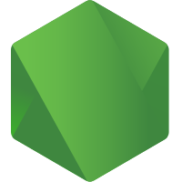

# Ringraziamenti e provenienza — Hydra One

Hydra One è un fork in beta di **Strata**, sviluppato da **Niko1221 e dai collaboratori di Strata**. Stargate Labs cura le modifiche e l’integrazione HYDRA One; non rivendica la paternità dei componenti upstream. Grazie agli autori, ai manutentori e ai collaboratori dei progetti su cui poggia questo lavoro.

## Codice e risorse inclusi

| Progetto / Project | Autori / Authors | Contributo / Contribution | Licenza / License |
|---|---|---|---|
| [Strata](https://github.com/Niko1221/Strata) | Niko1221 e collaboratori / contributors | Base del fork; motore nativo, server e interfaccia / Fork foundation: native engine, server and interface | MIT; licenses/Strata-MIT.txt |
| [llama.cpp / ggml](https://github.com/ggml-org/llama.cpp) | ggml authors e collaboratori / contributors | Backend, formati GGUF, quantizzazione, mtmd e strumenti / Backends, GGUF, quantization, mtmd and tools | MIT; licenses/ggml-MIT.txt; licenses/llama.cpp-MIT.txt |
| [Prism llama.cpp](https://github.com/PrismML-Eng/llama.cpp) | PrismML-Eng e autori upstream / upstream authors | Sorgente del loader HYDRA nativo / HYDRA native-loader source; commit e3de715222b2667c54a267441159a5729f11155e | MIT; licenses/Prism-llama.cpp-MIT.txt |
| [Soup](https://github.com/MakazhanAlpamys/Soup) | Makazhan Alpamys / Soup Team | Moduli di pianificazione inclusi / Bundled planning modules; commit 61e8c2bf354393cea85002401d0bde803b48f614 | Apache-2.0; licenses/Soup-* |
| [xterm.js](https://github.com/xtermjs/xterm.js) | xterm.js authors; SourceLair; Christopher Jeffrey | Terminale web / Web terminal | MIT; licenses/xterm-MIT.txt |
| [Lucide / Feather](https://github.com/lucide-icons/lucide) | Lucide Icons and Contributors; Cole Bemis | Icone UI e icone derivate da Feather / UI icons and Feather-derived icons | ISC / MIT; licenses/Lucide-Feather-LICENSE.txt |
| [Outfit](https://github.com/Outfitio/Outfit-Fonts) | The Outfit Project Authors | Caratteri dell’interfaccia / Interface font | SIL OFL 1.1; licenses/Outfit-OFL-1.1.txt |
| [Sora](https://github.com/sora-xor/sora-font) | The Sora Project Authors | Caratteri dell’interfaccia / Interface font | SIL OFL 1.1; licenses/Sora-OFL-1.1.txt |

Il riferimento llama.cpp del CMake principale è `3cf03257f219afbe7334045ff7c6a06ac68c627d`; il loader Prism usa il commit distinto indicato sopra. I testi originali di licenza e copyright sono conservati in [licenses](../licenses/). [LICENSE-MANIFEST.json](LICENSE-MANIFEST.json) ne registra provenienza e SHA-256.

## Integrazioni e strumenti opzionali

Grazie ai progetti **Unsloth, Transformers, PyTorch, AirLLM, Colibri, Whisper.cpp, audio.cpp, AudioCraft, VoiceStudio, OpenCode, DeepSeek Harness, TrueForge, Hermes Agent, Claude Code, Playwright e Model Context Protocol**. I riferimenti ufficiali sono ricavati dalle mappe dei componenti e dai sorgenti, non da un elenco promozionale. La loro presenza nel catalogo non certifica esecuzione, compatibilità universale o inclusione dei rispettivi sorgenti. Restano applicabili licenze e condizioni dei singoli componenti.

| Componente / Component | Sorgente ufficiale / Official source |
|---|---|
| airllm | [lyogavin/airllm](https://github.com/lyogavin/airllm) |
| audio.cpp | [unslothai/audio.cpp](https://github.com/unslothai/audio.cpp) |
| browser | [microsoft/playwright-mcp](https://github.com/microsoft/playwright-mcp) |
| claude | [anthropics/claude-code](https://github.com/anthropics/claude-code) |
| colibri | [JustVugg/colibri](https://github.com/JustVugg/colibri) |
| dsh | [deepseek-ai/deepseek-harness](https://github.com/deepseek-ai/deepseek-harness) |
| hermes | [NousResearch/hermes-agent](https://github.com/NousResearch/hermes-agent) |
| llama.cpp | [unslothai/llama.cpp](https://github.com/unslothai/llama.cpp) |
| memory | [modelcontextprotocol/servers](https://github.com/modelcontextprotocol/servers) |
| opencode | [anomalyco/opencode](https://github.com/anomalyco/opencode) |
| pytorch | [pytorch/pytorch](https://github.com/pytorch/pytorch) |
| soup | [MakazhanAlpamys/Soup](https://github.com/MakazhanAlpamys/Soup) |
| strata | [Niko1221/Strata](https://github.com/Niko1221/Strata) |
| transformers | [huggingface/transformers](https://github.com/huggingface/transformers) |
| trueforge | [truefoundry/trueforge](https://github.com/truefoundry/trueforge) |
| unsloth | [unslothai/unsloth](https://github.com/unslothai/unsloth) |
| voicestudio | [debpalash/VoiceStudio](https://github.com/debpalash/VoiceStudio) |
| whisper.cpp | [unslothai/whisper.cpp](https://github.com/unslothai/whisper.cpp) |

## Modelli e ricerca

Conserviamo i ringraziamenti upstream al **team Qwen**, **ISTA-DASLab**, **UkisAI**, **Unsloth** ed [eddoursul/Strata](https://github.com/eddoursul/Strata), insieme alle idee attribuite a [Splash](https://github.com/incoai/splash), [ninfer](https://github.com/Neroued/ninfer) e [HyperQwen](https://github.com/syv-ai/HyperQwen). I contributi citati dalla documentazione Strata includono [@pjgmobile](https://github.com/pjgmobile) (Coder, PR #54), [@code-martin](https://github.com/code-martin) (idea del monitor, PR #22) e [@bsorensen110](https://github.com/bsorensen110) (ottimizzazioni AMD, PR #329 e #337). L’attribuzione non trasferisce a Hydra i benchmark upstream.

Gli altri editori e modelli referenziati dal catalogo sono elencati nell’inventario delle sorgenti. I pesi non sono coperti dalla licenza del fork: valgono le rispettive model card, licenze, restrizioni e condizioni di accesso. Lo stesso vale per dataset e vettori derivati dalle attivazioni dei modelli.

## Dipendenze, loghi e inventario

Le dipendenze Python dirette e transitive fissate dal progetto sono elencate in [PYTHON-DEPENDENCIES.txt](PYTHON-DEPENDENCIES.txt). Python, NumPy, Jinja2 e gli altri pacchetti mantengono i propri autori e licenze. L’elenco non sostituisce le licenze distribuite con ciascun pacchetto.

I loghi **Stargate Labs** e **Hydra One** sono le risorse originali del progetto. Loghi e marchi di terzi identificano i rispettivi progetti; non implicano affiliazione o approvazione e non vengono rilasciati automaticamente sotto MIT. Le mappe originali degli asset sono conservate nell’interfaccia.

[SOURCE-REFERENCES.json](SOURCE-REFERENCES.json) registra i collegamenti GitHub e Hugging Face trovati nei sorgenti e nella documentazione, con file e riga di origine. Include anche riferimenti di ricerca e test: citarli non significa includerne codice o dichiararne il supporto. L’inventario è verificabile e va aggiornato quando cambiano i componenti.

[English credits](CREDITS.en.md)

## Loghi originali e inventario verificato

          

[Inventario dei loghi con SHA-256](BRAND-ASSETS.json). Le risorse della mod sono conservate senza alterarne i byte; l’identità della nostra versione usa Hydra One. I marchi di terzi restano dei rispettivi titolari.

[Applications, functions, official logos and authors / App, funzioni, loghi ufficiali e autori](APPLICATIONS.it.md)
